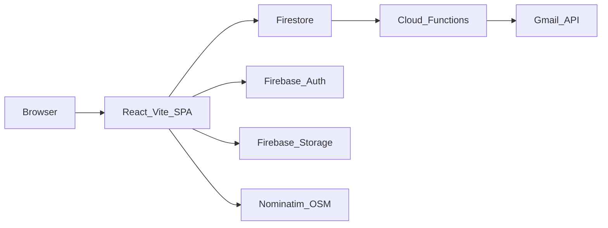

# T-Connect

歐洲旅行連結平台：在地圖上發布與瀏覽沙發住宿、旅伴與地陪，並透過聊天室完成媒合。

正式環境：<https://travelconnect-4a4df.web.app>  
Firebase 專案：`travelconnect-4a4df`（npm package 名稱為 `euroconnect`）

---

## 架構概覽

前端為 Vite + React SPA。登入、資料與檔案分別使用 Firebase Authentication、Cloud Firestore 與 Firebase Storage；Hosting 提供靜態網站，Cloud Functions 處理排程清理與郵件通知。發文時以 OpenStreetMap Nominatim 做地理編碼。



---

## Features

- **地圖首頁**：Leaflet + OpenStreetMap 顯示沙發、旅伴、地陪標記，支援類型圖層與聚合圖示。
- **三種貼文**：提供住宿（`/host`）、尋找旅伴（`/companion`）、成為地陪（`/local`）；登入後可新增，並支援對應的編輯路由。
- **搜尋與抽屜**：以地點／關鍵字搜尋，點擊標記開啟貼文詳情與同地點列表。
- **公開分享頁**：`/post/:postType/:postId` 無需登入即可查看單一貼文。
- **帳號系統**：Email / Password、Google 登入、忘記密碼；註冊時自動建立 `profiles` 基本檔案。
- **聊天室**：申請貼文時檢查既有申請與聊天室，避免重複建立；新訊息寫入 Firestore 後由 `sendChatNotification` 寄信。
- **評論與評價**：貼文評論（`comments`）與用戶評價（`userReviews`）。
- **過期貼文清理**：Cloud Function `cleanupExpiredPosts` 每日歐洲時間 02:00（`Europe/London`）清理 `couches`、`companions`、`locals` 中已過期貼文；前端亦有 `useAutoCleanup`，管理員頁面為 `/admin/cleanup`。
- **地理編碼**：發布貼文時以 Nominatim 將地址轉成座標，並依國家名稱優先挑選結果。
- **個人檔案**：公開檔案 `/profile/:userId`、登入後編輯 `/profile`；後端會定期補齊缺少的基本檔案。
- **意見回饋與條款**：`/feedback`、`/terms`、`/privacy`。

更細的清理與聊天室邏輯見 [README_NEW_FEATURES.md](README_NEW_FEATURES.md)；自動化與郵件相關見 [AUTOMATION_SETUP_README.md](AUTOMATION_SETUP_README.md)。

---

## Tech Stack

### Frontend

| 項目 | 套件 / 版本 |
| --- | --- |
| 語言 | JavaScript (ES modules) |
| UI | React 18、React Router 7 |
| 建置 | Vite 5、`@vitejs/plugin-react` |
| 樣式 | Tailwind CSS 3、PostCSS、Autoprefixer |
| 地圖 | Leaflet 1.9、react-leaflet 4 |
| 圖示 | lucide-react |
| Firebase 客戶端 | firebase 11（Auth、Firestore、Storage、Analytics） |

### Backend / Infra

| 項目 | 套件 / 服務 |
| --- | --- |
| 執行環境 | Cloud Functions（Node.js 22） |
| Functions SDK | firebase-functions 6（v2：`onRequest`、`onSchedule`、`onDocumentCreated`） |
| Admin | firebase-admin |
| 郵件 | googleapis、nodemailer、Gmail OAuth2 |
| 資料庫 | Cloud Firestore（集合見下方） |
| 檔案 | Firebase Storage |
| 託管 | Firebase Hosting（`dist`，SPA rewrite 至 `/index.html`） |
| Secrets | Google Cloud Secret Manager：`GMAIL_CLIENT_ID`、`GMAIL_CLIENT_SECRET`、`GMAIL_REFRESH_TOKEN`、`GMAIL_EMAIL` |

### Firestore 主要集合

`couches`、`companions`、`locals`、`profiles`、`chatrooms`（含子集合 `messages`）、`comments`、`userReviews`、`feedback`

### 非主路徑後端

[`euroconnect-backend/`](euroconnect-backend/) 為獨立 Express API（`/api/auth`、`/api/posts`、`/api/contact`）。目前前端 **沒有** 呼叫這些端點，本地跑 SPA **不必** 啟動此服務。

---

## 專案目錄結構

```text
T-Connect/
├── src/                          # 主前端應用
│   ├── main.jsx                  # 入口，包裝 AuthProvider
│   ├── App.jsx                   # 路由與自動清理 hook
│   ├── firebase.js               # Firebase 客戶端初始化與集合引用
│   ├── index.css                 # Tailwind 進入點
│   ├── contexts/AuthContext.jsx  # 登入、註冊、Google、重設密碼
│   ├── components/               # Navbar、PrivateRoute、地圖抽屜、搜尋列等
│   ├── pages/
│   │   ├── home/ExchangePlatform.jsx
│   │   ├── host/                 # 沙發貼文
│   │   ├── companion/            # 旅伴貼文
│   │   ├── local/                # 地陪貼文
│   │   ├── auth/                 # Login、Signup
│   │   ├── chatroom/             # 列表與對話
│   │   ├── profile/              # 個人與公開檔案
│   │   ├── post/PostDetail.jsx   # 公開分享頁
│   │   ├── admin/                # 過期貼文清理
│   │   ├── Feedback.jsx
│   │   └── Terms.jsx
│   ├── hooks/useAutoCleanup.js
│   └── utils/                    # chat、cleanup、geocoding、comment、review
├── functions/                    # 正式 Cloud Functions（firebase.json source）
│   ├── index.js
│   └── package.json
├── euroconnect-backend/          # 未接上前端的 Express API
├── chat-notifications/           # 舊版 Functions 副本，非正式部署來源
├── my-project/                   # Vite 範本，非主應用
├── index.html                    # SPA HTML、OG meta
├── vite.config.js
├── tailwind.config.js
├── firebase.json                 # Hosting、Storage rules、Functions
├── .firebaserc                   # 專案別名 default / prod → travelconnect-4a4df
├── firestore.rules
├── storage.rules
├── release.sh                    # 建置並部署 Hosting
├── package.json
└── dist/                         # `npm run build` 產物（Hosting public）
```

根目錄另有操作說明與輔助腳本（例如 `ENV_SETUP_GUIDE.md`、`set-secrets.sh`、`profile-check.sh`），部署時請用 placeholder 設定 secrets，勿把真實 token 提交進 git。

---

## 本地開發

### 前置需求

- Node.js（前端建議 18+；Cloud Functions 引擎為 **22**）
- npm
- 開發 Functions 或部署時需要 [Firebase CLI](https://firebase.google.com/docs/cli)

### 安裝與啟動前端

```bash
npm install
npm run dev
```

Vite 會啟動開發伺服器（預設 `http://localhost:5173`）。

其他常用指令：

```bash
npm run lint      # ESLint
npm run build     # 產出 dist/
npm run preview   # 預覽正式建置
```

### 環境變數

前端 Firebase 設定寫在 `src/firebase.js`，**沒有** `VITE_*` 環境變數。只要該檔的 `projectId` 與本機使用的 Firebase 專案一致即可連上 Auth / Firestore。

郵件通知相關變數只給 Cloud Functions 使用。本地根目錄可建立 `.env`（已列入 `.gitignore`）：

```bash
GMAIL_CLIENT_ID=YOUR_CLIENT_ID_HERE
GMAIL_CLIENT_SECRET=YOUR_CLIENT_SECRET_HERE
GMAIL_REFRESH_TOKEN=YOUR_REFRESH_TOKEN_HERE
GMAIL_EMAIL=your-sender@example.com
```

正式環境請用 Secret Manager（函數已宣告上述四個 secret 名稱），細節見 [ENV_SETUP_GUIDE.md](ENV_SETUP_GUIDE.md)。

### Cloud Functions（可選）

```bash
cd functions
npm install
cd ..
firebase emulators:start --only functions
```

若要對正式專案部署 Functions（需已設定 secrets 並登入 CLI）：

```bash
firebase use default
firebase deploy --only functions
```

---

## 測試與部署

### 測試

目前沒有自動化單元測試套件。`functions` 雖依賴 `firebase-functions-test`，但尚未撰寫測試檔。根目錄的 `test-firebase.js`、`test-share.html` 等為手動檢查用腳本。

建議部署前：

```bash
npm run lint
npm run build
```

Functions 日誌：

```bash
firebase functions:log
# 或
cd functions && npm run logs
```

### Firebase Hosting

[`firebase.json`](firebase.json) 設定：

- `hosting.public`：`dist`
- SPA rewrite：所有路徑 → `/index.html`
- `functions.source`：`functions`
- `storage.rules`：`storage.rules`

注意：`firestore.rules` 存在於倉庫，但目前 **未** 寫入 `firebase.json` 的 `firestore` 區塊；若要一併部署規則，需先補上設定再執行對應的 `firebase deploy`。

手動部署 Hosting：

```bash
npm run build
firebase deploy --only hosting --project travelconnect-4a4df
```

或使用腳本（會清理 `dist`、安裝依賴、建置並部署 Hosting）：

```bash
./release.sh
```

正式網址：`https://travelconnect-4a4df.web.app`

### Cloud Functions

```bash
firebase deploy --only functions
```

| 函數 | 觸發 | 用途 |
| --- | --- | --- |
| `cleanupExpiredPosts` | Schedule（每日 02:00，`Europe/London`） | 刪除過期沙發／旅伴／地陪貼文 |
| `cleanupExpiredPostsManual` | HTTP | 手動觸發清理 |
| `sendChatNotification` | Firestore `chatrooms/{id}/messages/{id}` 建立 | 寄信通知對方 |
| `monitorUserRegistration` | Firestore `profiles` 建立 | 記錄註冊統計 |
| `periodicProfileCheck` | Schedule | 為缺少檔案的 Auth 用戶補基本 `profiles` |
| `manualProfileCheck` | HTTP | 手動檢查／補檔案 |
| `createBasicProfiles` | HTTP | 批次建立基本檔案 |
| `sendSystemNotification` | HTTP（需 Bearer Token） | 向啟用郵件通知的用戶發送系統信 |
| `helloWorld` | HTTP | 連線測試 |

系統通知工具說明見 [SYSTEM_NOTIFICATION_README.md](SYSTEM_NOTIFICATION_README.md)。部署前安全檢查見 [DEPLOYMENT_CHECKLIST.md](DEPLOYMENT_CHECKLIST.md)。
